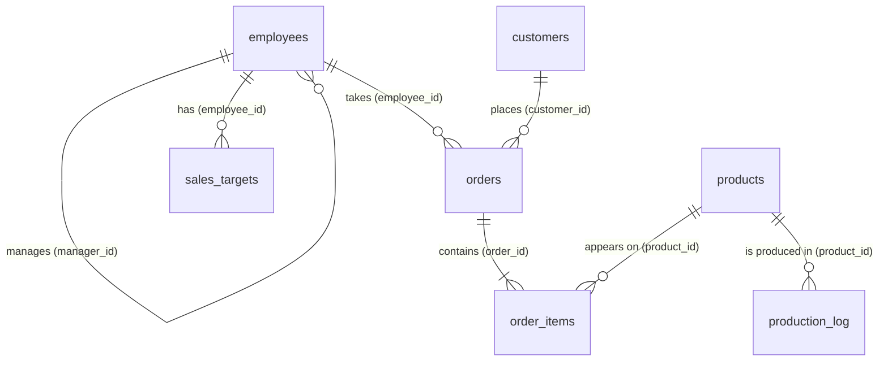

# Practice Database: `business_db`

A fictional South African industrial supplier, **Karoo Industrial Supplies**, which sells and services evaporative coolers, cooling towers, fans, pumps, spares and water treatment products. I use this one database for every lesson and challenge in the SQL phase.

All companies, people and figures are invented for learning. Currency is South African rand (ZAR).

- **Database engine:** PostgreSQL
- **Setup script:** [`business_db_setup.sql`](business_db_setup.sql)
- **Period covered:** sales from 1 January to 31 December 2025; production log for September 2025

## Tables

| Table | Rows | What one row is | Primary key |
|---|---|---|---|
| `employees` | 15 | A staff member (management, sales, operations, finance) | `employee_id` |
| `customers` | 42 | A business customer | `customer_id` |
| `products` | 26 | A product or service the company sells | `product_id` |
| `orders` | 130 | A customer order taken by a sales employee | `order_id` |
| `order_items` | 258 | One product line on an order | `order_item_id` |
| `sales_targets` | 70 | A sales rep's revenue target for one month | `target_id` |
| `production_log` | 96 | One shift on one production line | `log_id` |

## How the tables connect

| From (foreign key) | To (primary key) | Meaning |
|---|---|---|
| `orders.customer_id` | `customers.customer_id` | Which customer placed the order |
| `orders.employee_id` | `employees.employee_id` | Which sales employee took the order |
| `order_items.order_id` | `orders.order_id` | Which order the line belongs to |
| `order_items.product_id` | `products.product_id` | Which product was sold |
| `sales_targets.employee_id` | `employees.employee_id` | Whose target it is |
| `production_log.product_id` | `products.product_id` | Which product the shift made |
| `employees.manager_id` | `employees.employee_id` | Who the employee reports to (a self-reference) |

## Column notes

- **Revenue of an order line** = `quantity * unit_price * (1 - discount)`. `discount` is a fraction (0.10 = 10%).
- `order_items.unit_price` is the price charged on the day, so it can differ from `products.unit_price` (prices rose about 6% from 1 July 2025).
- `orders.status` is `Shipped`, `Pending` or `Cancelled`. `shipped_date` is NULL when the order has not shipped.
- `products.discontinued` is TRUE for products no longer sold.
- `production_log` supports OEE work: availability from `planned_minutes` and `downtime_minutes`, performance from `ideal_cycle_seconds` and `units_produced`, and quality from `units_defective`. `downtime_reason` is NULL when there was no downtime.

## Built-in features for lessons

These are deliberate, so the lessons have something to find:

- **NULL values:** some customers have no phone number, some orders have no shipped date, the managing director has no manager, and shifts with no downtime have no reason.
- **Unmatched rows:** some customers have never ordered and one product has never been sold (for LEFT and FULL JOIN).
- **Self-join:** `employees.manager_id` points back into `employees`.
- **Uneven performance:** some reps beat their targets and some miss them.
- **Stock problems:** some products are at or below their reorder level.

## How to load it

1. Open pgAdmin 4 and connect to the server.
2. Right-click `business_db` and choose **Query Tool**.
3. Click the **Open File** (folder) icon and select `business_db_setup.sql`.
4. Press **F5** to run it.
5. The last result shows the row count for each table. Check that it matches the table above.
6. Right-click **business_db > Schemas > public > Tables** and choose **Refresh** to see the seven tables.

The script drops and rebuilds all seven tables, so running it again resets the database to its original state.
